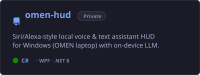

  <!-- Venom Header (SVG + CSS Keyframe Animation) -->
  

 

<!-- Interactive 3D GitHub Activity Card (Isometric Terrain + Radar + Languages + KPIs) -->

  

 

<!-- Minimal Core Arsenal -->
<h2 align="center">Core Arsenal</h2>
 

  

 

<!-- Featured Systems & Workspaces -->
<h2 align="center">Featured Systems &amp; Workspaces</h2>
 

  
  

  
  

 

  <!-- Venom Footer (SVG + CSS Wave Animation) -->
  

